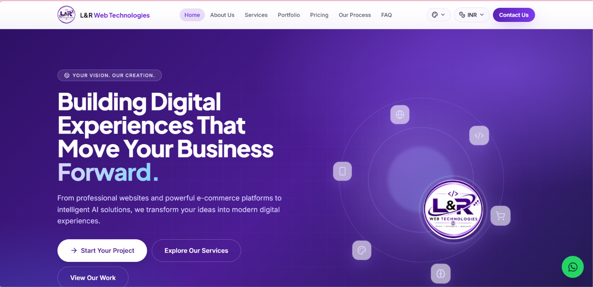
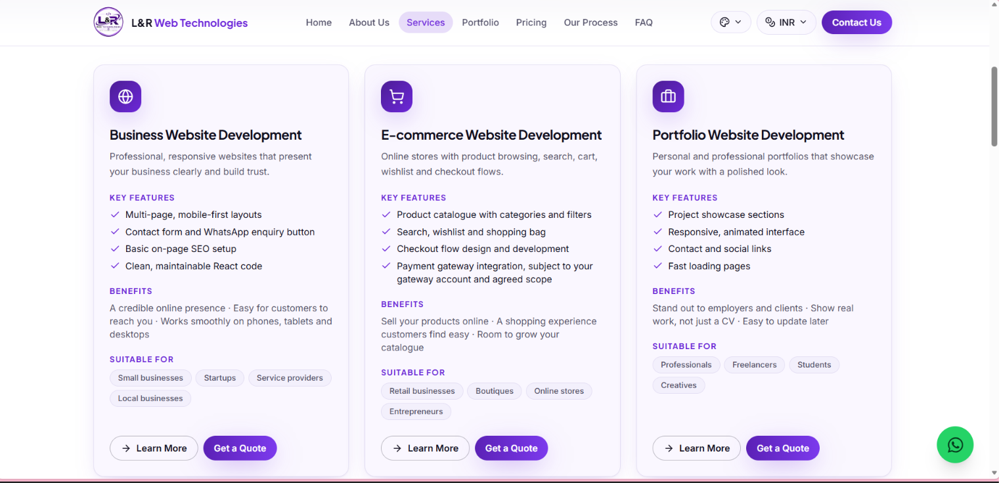
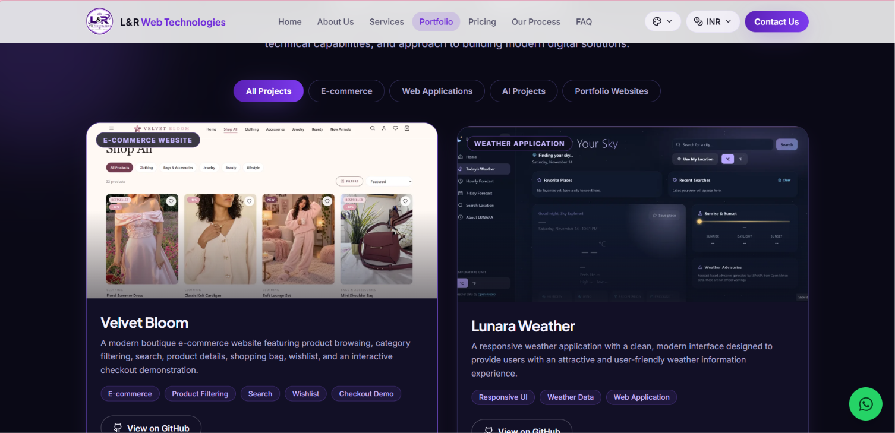

<div align="center">


# L&R WEB TECHNOLOGIES

### Your Vision. Our Creation.

**Turning Ideas Into Powerful Digital Experiences.**

A modern, interactive business website designed and developed to showcase digital services, creative solutions, and technology-driven development.

<br/>


<br/><br/>

[Explore Features](#-key-features) •
[Tech Stack](#-technology-stack) •
[Installation](#-getting-started) •
[Contact](#-connect-with-me)

</div>

---

## ✨ About The Project

**L&R Web Technologies** is a modern business website created to represent a digital development brand offering website development, e-commerce solutions, custom web applications, and AI-powered services.

I designed and developed this platform with a focus on modern UI/UX, responsive layouts, interactive components, and practical business functionality.

Rather than being just a company landing page, this website is designed as a complete client acquisition platform where visitors can explore services, discover projects, estimate development costs, generate project briefs, and submit enquiries.

### 🎯 Project Goals

- Establish a professional digital presence.
- Showcase development capabilities and projects.
- Present services and pricing transparently.
- Make client communication easier.
- Provide interactive tools for potential customers.
- Create a smooth experience across desktop, tablet, and mobile.

---

## 🖥️ Website Preview

<div align="center">

<!-- Replace these paths with your actual screenshots -->



**Homepage – Modern Digital Agency Experience**

<br/><br/>



**Services – Digital Solutions and Development Services**

<br/><br/>



**Portfolio – Showcasing Our Own Projects**

</div>

---

## 🚀 Key Features

<table>
<tr>
<td width="50%">

### 🎨 Modern UI/UX
- Premium purple branding.
- Three selectable themes.
- Smooth animations.
- Interactive components.
- Responsive layouts.

</td>
<td width="50%">

### 💻 Business Services
- Website development.
- E-commerce development.
- Custom web applications.
- AI-powered solutions.
- UI/UX design.

</td>
</tr>

<tr>
<td width="50%">

### 📊 Project Cost Estimator
- Interactive requirement selection.
- Dynamic price estimation.
- Feature-based calculations.
- Project summary generation.
- WhatsApp enquiry integration.

</td>
<td width="50%">

### 📝 Project Brief Generator
- Business requirement collection.
- Project description generation.
- Budget and timeline selection.
- Copyable project summaries.
- Enquiry integration.

</td>
</tr>

<tr>
<td width="50%">

### 💬 Client Communication
- WhatsApp quick enquiry.
- Contact form.
- Email notifications.
- FAQ chat assistant.
- Multiple contact options.

</td>
<td width="50%">

### 🌍 International Support
- INR currency.
- USD currency.
- EUR currency.
- GBP currency.
- Approximate currency conversion.

</td>
</tr>
</table>

### Additional Features

- Dedicated service detail pages.
- Interactive portfolio gallery.
- Project category filtering.
- Pricing comparison.
- Development process timeline.
- Client testimonials section.
- Privacy Policy and Terms pages.
- SEO-friendly page structure.
- Local storage theme preferences.

---

## 🛠️ Technology Stack

### Frontend

<p>


</p>

### Animations & Icons

<p>


</p>

### Backend & Database

<p>


</p>

### Development Tools

<p>


</p>

---

## 📂 Project Structure

```text
L&R-Web-Technologies/
│
├── public/
│   ├── images/
│   ├── logo.png
│   ├── robots.txt
│   └── sitemap.xml
│
├── src/
│   ├── components/
│   ├── pages/
│   ├── data/
│   │   ├── site.ts
│   │   ├── pricing.ts
│   │   ├── estimator.ts
│   │   ├── services.ts
│   │   ├── projects.ts
│   │   ├── testimonials.ts
│   │   ├── faq.ts
│   │   └── process.ts
│   │
│   ├── App.tsx
│   └── main.tsx
│
├── server/
│   ├── main.py
│   ├── requirements.txt
│   ├── .env.example
│   └── enquiries.db
│
├── index.html
├── package.json
├── vite.config.ts
├── tailwind.config.js
└── README.md
```

*The structure above illustrates the main application organization. Individual files may vary as the project evolves.*

---

## ⚙️ Getting Started

Follow these steps to run the project locally.

### Prerequisites

Make sure you have installed:

- Node.js 18 or later.
- npm.
- Python 3.10 or later.
- Git.
- VS Code (recommended).

### 1. Clone the Repository

```bash
git clone YOUR_REPOSITORY_URL
```

```bash
cd YOUR_PROJECT_FOLDER
```

### 2. Install Dependencies

```bash
npm install
```

### 3. Start the Development Server

```bash
npm run dev
```

Open your browser:

```text
http://localhost:5173
```

### 4. Create Production Build

```bash
npm run build
```

### 5. Preview Production Build

```bash
npm run preview
```

---

## 🐍 Backend Setup – FastAPI

The contact form uses a FastAPI backend to process enquiries and send email notifications.

### 1. Navigate to Server

```bash
cd server
```

### 2. Create Virtual Environment

Windows:

```powershell
python -m venv .venv
```

Activate:

```powershell
.venv\Scripts\activate
```

### 3. Install Requirements

```bash
pip install -r requirements.txt
```

### 4. Configure Environment Variables

Copy the example environment file:

```powershell
Copy-Item .env.example .env
```

Configure the required environment variables in `.env`.

### 5. Start FastAPI

```bash
uvicorn main:app --reload --port 8000
```

Backend address:

```text
http://127.0.0.1:8000
```

During development, run both the frontend and backend servers.

### 📧 Email Configuration

The contact form uses SMTP email delivery.

To configure Gmail:

1. Enable Google 2-Step Verification.
2. Generate a Google App Password.
3. Add the credentials to the backend `.env` file.
4. Configure the notification email address.
5. Never expose SMTP credentials in frontend code.

The backend also uses SQLite to store valid enquiries.

---

## 🌐 Deployment

The application supports separate frontend and backend deployment.

### Frontend

Suitable hosting platforms:

- Vercel
- Netlify
- Other static hosting providers.

### Backend

Suitable hosting platforms:

- Render
- Railway
- Fly.io
- VPS hosting.

Configure the production API URL using:

```env
VITE_API_URL=https://your-backend-domain.com
```

Configure backend environment variables and allowed frontend origins before deployment.

---

## 🔐 Security & Reliability

The application includes:

- Server-side contact form processing.
- Hidden honeypot spam protection.
- Minimum form-fill-time validation.
- Per-IP rate limiting.
- Privacy consent.
- SQLite enquiry storage.
- Environment-based credentials.
- Frontend/backend separation.

Never commit `.env` files, SMTP passwords, or private credentials to GitHub.

---

## 🎨 Design Philosophy

The visual identity of L&R Web Technologies focuses on a premium purple and dark technology-inspired aesthetic.

The design combines:

- Modern typography.
- Clean layouts.
- Smooth transitions.
- Interactive elements.
- Consistent spacing.
- Accessible components.
- Mobile-first responsiveness.

The goal is to create an experience that feels modern, professional, and trustworthy.

---

## 👩‍💻 Designed & Developed By

<div align="center">

### LAVANYA R

**AI & Data Science | Web Developer**

I am a final-year B.Tech Artificial Intelligence and Data Science student interested in building practical digital products, modern web applications, and AI-powered solutions.

I enjoy transforming ideas into functional applications through creativity, problem-solving, and continuous learning.

This project represents my work in combining frontend development, backend integration, UI/UX design, and practical business functionality.

<br/>

<a href="https://github.com/Lavanya-Ram1801">

</a>

<a href="https://www.linkedin.com/in/lavanya-90390b2a4/">

</a>

</div>

---

## 📬 Contact

**L&R Web Technologies**

- Email: lrwebtechnologies@gmail.com
- Instagram: @lrweb_technologies
- GitHub: https://github.com/Lavanya-Ram1801

For website development, e-commerce solutions, custom applications, and AI-powered projects, feel free to get in touch.

---

<div align="center">

### YOUR VISION. OUR CREATION.

**Built with creativity, code, and a passion for technology.**

<br/>


<br/><br/>

⭐ If you like this project, consider giving it a star!

</div>